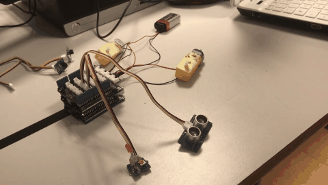
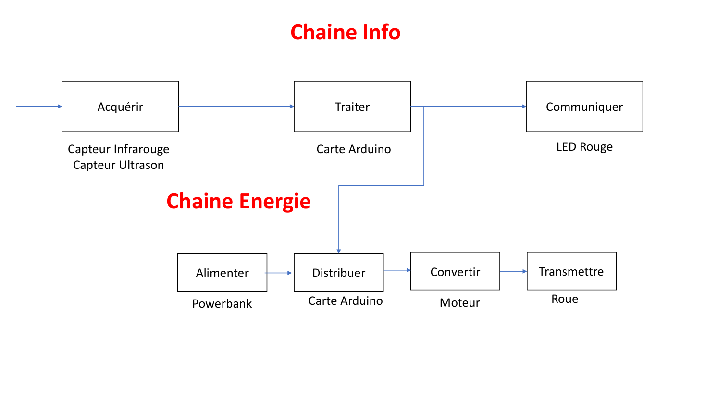
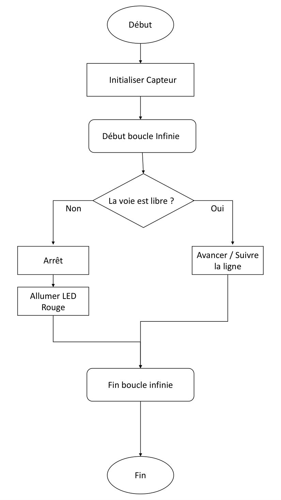
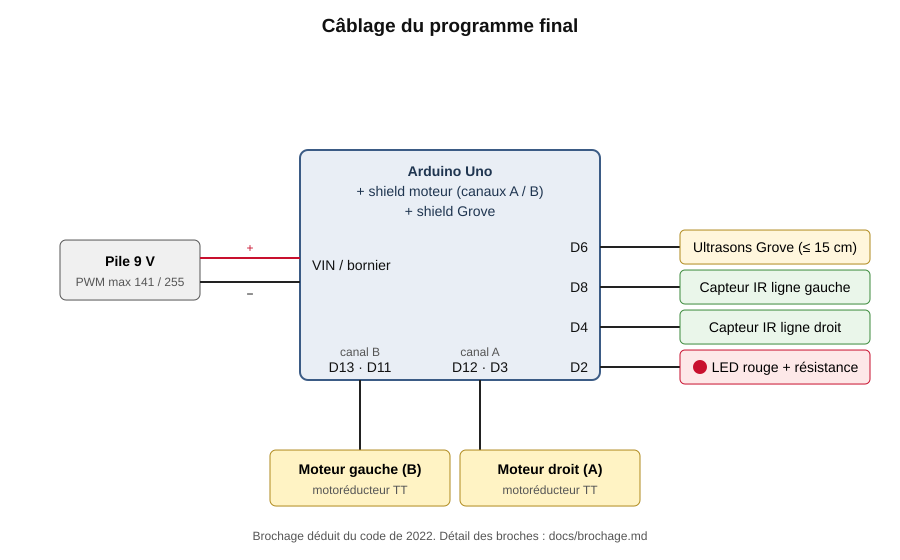
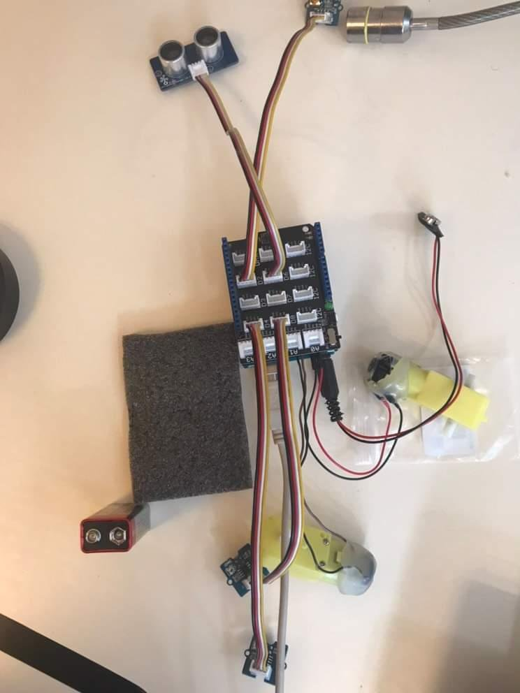
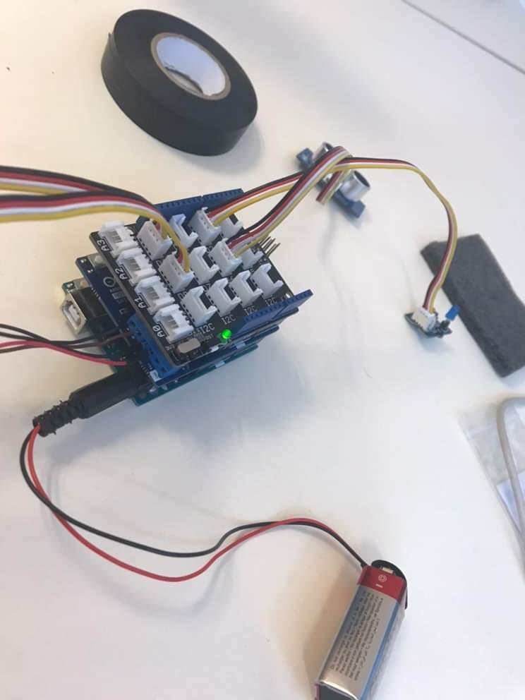
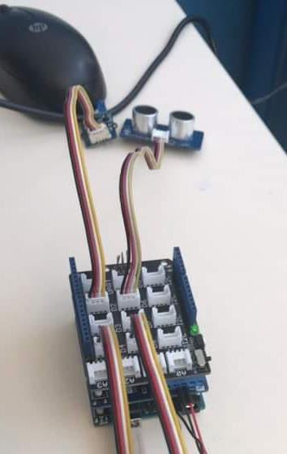

# Transporteur autonome : suivi de ligne et arrêt devant obstacle (Arduino)

🇫🇷 [Français](#français) · 🇬🇧 [English](#english)



---

## Français

### Contexte
Projet de fin d'année de **1re STI2D** (mai 2022, environ 36 h), sur le thème « assister l'homme ». Le cahier des charges est le suivant : un petit transporteur autonome livre du matériel dans un hôpital. Il **suit une ligne noire au sol**, **s'arrête devant un obstacle** et **le signale par une LED rouge**.

Ce dépôt contient mon code Arduino (les étapes intermédiaires et le programme final), la pièce SolidWorks du support, les schémas de principe et des photos du câblage.

### Architecture



| Fonction | Composant retenu | Pourquoi (et alternative écartée) |
|---|---|---|
| Suivre la ligne | 2 capteurs infrarouges à sortie numérique (noir = HIGH) | Simple à lire avec `digitalRead`, peu cher. Le capteur optique QTR à sortie RC demande une mesure de temps de décharge. |
| Détecter un obstacle | Télémètre à ultrasons Grove (2 à 500 cm) | Il arrête le robot **avant** le contact. Un capteur de choc ne réagit qu'une fois l'obstacle touché. |
| Traiter | Arduino Uno + shield moteur + shield Grove | Facile à programmer, assez d'entrées/sorties. |
| Faire avancer | 2 motoréducteurs « TT » jaunes (3 à 12 V) | Assez de couple pour une roue et à la bonne taille. Un micro-moteur était trop faible, un pas-à-pas inutilement complexe. |
| Alimenter | Pile 9 V pour les essais (une batterie USB 5 V, 2 A était prévue) | — |
| Signaler | LED rouge | — |

### Algorithme



### Le code, étape par étape
J'ai construit le programme par morceaux, testés séparément avant d'être assemblés :

| Dossier | Rôle |
|---|---|
| [`code/premiere_version_hcsr04`](code/premiere_version_hcsr04) | Première version avec un HC-SR04 (broches TRIG/ECHO) et un autre câblage des moteurs : le robot tourne sur lui-même quand un obstacle est à moins de 20 cm. |
| [`code/detection_obstacle_led`](code/detection_obstacle_led) | Ultrason Grove seul : la LED s'allume à 15 cm ou moins. |
| [`code/suivi_de_ligne`](code/suivi_de_ligne) | Suivi de ligne seul avec deux capteurs : noir à gauche → tourner à gauche, noir à droite → tourner à droite, sinon tout droit. |
| [`code/programme_final`](code/programme_final) | Les deux réunis : suivi de ligne, et à 15 cm ou moins, arrêt des moteurs et LED allumée pendant 5 s. |

Un détail du programme final : les moteurs sont prévus pour environ 5 V, mais la pile fait 9 V. La consigne PWM maximale est donc limitée à `5 × 255 / 9 ≈ 141`, ce qui donne en moyenne à peu près 5 V aux bornes des moteurs.

### Montage



Le détail broche par broche est dans [`docs/brochage.md`](docs/brochage.md).

| | | |
|---|---|---|
|  |  |  |

La pièce [`cao/support_principal.SLDPRT`](cao/support_principal.SLDPRT) est le support que j'ai dessiné sous SolidWorks pour porter la carte et les capteurs.

### Résultat
Le montage a été testé sur table, moteurs posés à côté de la carte (voir l'animation en haut de page) : les moteurs tournent, et j'approche ma main du capteur à ultrasons pour déclencher l'arrêt et la LED.

### Relecture en 2026 : limites et ce que je ferais autrement
J'ai relu ce code quatre ans plus tard. Je le laisse tel qu'il était en 2022, mais voici ce que j'y vois aujourd'hui :

1. **La boucle est bloquante.** `delay(150)` à chaque tour, et `delay(5000)` à l'arrêt : pendant ce temps, les capteurs de ligne ne sont pas lus. À vitesse réelle, le robot peut dépasser la ligne entre deux lectures. La première version avait aussi un `delay(500)` à chaque mesure. Je remplacerais tout cela par une boucle non bloquante avec `millis()`.
2. **Il redémarre avant de regarder.** Après les 5 s d'arrêt, le tour suivant commence par le suivi de ligne : les moteurs repartent *avant* la nouvelle mesure de distance. Si l'obstacle est toujours là, le robot avance un instant puis s'arrête à nouveau. Il faut mesurer d'abord, puis décider.
3. **Pas d'écho = 0 cm.** Quand le capteur ne reçoit pas d'écho (rien devant, ou cible absorbante), la mesure vaut 0 (`pulseIn` qui expire dans la première version, et de même avec la bibliothèque Grove), et 0 est traité comme un obstacle. Dans la première version, le robot se met alors à tourner. C'est prudent par défaut, mais il faudrait distinguer « obstacle proche » et « mesure invalide ».
4. **La LED ne clignote pas.** Le cahier des charges demandait une LED *clignotante*, alors que le programme l'allume en continu. Un clignotement non bloquant (basé sur `millis()`) règle ce point en même temps que le point 1.
5. **Ligne perdue.** Si les deux capteurs voient du blanc, le robot continue tout droit au lieu de chercher la ligne. Un petit automate (SUIVI → OBSTACLE → RECHERCHE) serait plus robuste. Avec `LOW_SPEED = 0`, chaque virage arrête aussi complètement une roue, ce qui donne une conduite saccadée.
6. **Une broche à vérifier.** Sur le shield moteur Arduino R3, la broche D8 sert aussi de frein au canal B. Or le programme y lit un capteur de ligne. Il faudrait le déplacer sur une broche libre.
7. **L'alimentation n'est pas cohérente.** Le schéma prévoit une batterie USB 5 V, alors que les essais et le calcul PWM utilisent une pile 9 V. Il faut en choisir une et mesurer la tension réelle : une pile 9 V qui se décharge réduit aussi la vitesse.
8. **Détails.** Le test `valeur_en_cm <= 10000000000000000` ne sert à rien, et certains commentaires ne correspondent plus au code (« strictement inférieure » pour un `<=`, « inférieure à 30 cm »).

### Ce que le projet m'a appris
- découper un système en **chaîne d'information** et **chaîne d'énergie** avant de choisir les composants ;
- comparer des solutions selon des critères (programmation, coût, portée, couple) ;
- développer **par étapes testables** avant d'intégrer ;
- et, avec le recul : une boucle embarquée ne doit jamais rester bloquée.

### Contenu du dépôt
```
code/       4 croquis Arduino (.ino), dans l'état de 2022
cao/        support principal (SolidWorks)
docs/       brochage.md : broche, composant, rôle
images/     schéma de câblage (SVG), chaînes, algorigramme, photos du câblage, animation de l'essai
```
Les bibliothèques Arduino utilisées (Grove `Ultrasonic`) ne sont pas incluses : elles s'installent avec le gestionnaire de bibliothèques de l'IDE Arduino.

---

## English

### Context
End-of-year project in my **first year of STI2D** (French technology high-school track, May 2022, about 36 hours), on the theme "assisting people". The brief: a small autonomous carrier delivers supplies in a hospital. It **follows a black line**, **stops in front of an obstacle** and **signals it with a red LED**.

This repository contains my Arduino code (intermediate steps and final program), the SolidWorks support part, the block diagrams and photos of the wiring.

### Architecture
See the information/energy chain diagram above.
- **Line following:** 2 digital infrared sensors (black = HIGH), simpler to read than an RC-output QTR sensor.
- **Obstacle detection:** Grove ultrasonic ranger (2 to 500 cm), which stops the robot *before* contact, unlike a bump sensor.
- **Processing:** Arduino Uno + motor shield + Grove shield.
- **Drive:** 2 yellow "TT" gear motors (3 to 12 V), with enough torque and the right size.
- **Power:** 9 V battery for testing (a 5 V / 2 A USB power bank was planned).
- **Signal:** red LED.

### The code, step by step
| Folder | Purpose |
|---|---|
| `code/premiere_version_hcsr04` | First version with an HC-SR04 and different motor wiring: the robot spins when an obstacle is closer than 20 cm. |
| `code/detection_obstacle_led` | Grove ultrasonic sensor only: the LED lights up at 15 cm or less. |
| `code/suivi_de_ligne` | Line following only, with two sensors. |
| `code/programme_final` | Both combined: line following, and at 15 cm or less the motors stop and the LED stays on for 5 s. |

The motors are rated for about 5 V but the battery is 9 V, so the maximum PWM value is capped at `5 × 255 / 9 ≈ 141` (about 5 V on average across the motors).

### Result
Bench test on a table, with the motors lying next to the board (see the animation at the top): the motors run, and I bring my hand close to the ultrasonic sensor to trigger the stop and the LED. Wiring diagram above; pin-by-pin mapping in [`docs/brochage.md`](docs/brochage.md).

### 2026 review: limitations and what I would do differently
I left the 2022 code unchanged, but this is what I see in it today:
1. **Blocking loop.** `delay(150)` on every pass and `delay(5000)` when stopped mean the line sensors are not read during that time. At real speed, the robot can overshoot the line. I would use a non-blocking `millis()` loop instead.
2. **It restarts before looking.** After the 5 s stop, the next pass starts with line following, so the motors restart *before* the new distance reading.
3. **No echo reads as 0 cm.** When `pulseIn` times out, the reading is 0, which is treated as an obstacle. That is a safe default, but "close obstacle" and "invalid reading" should be told apart.
4. **The LED does not blink,** although the brief asked for a blinking LED.
5. **Lost line.** When both sensors see white, the robot goes straight instead of searching. A small state machine (FOLLOW → OBSTACLE → SEARCH) would be more robust. With `LOW_SPEED = 0`, every turn also stops one wheel completely.
6. **Pin to check.** On the Arduino Motor Shield R3, D8 is also the channel B brake, yet a line sensor is read on it.
7. **Inconsistent power supply.** The diagram plans a 5 V power bank, while the tests and the PWM cap assume a 9 V battery.
8. **Minor:** a useless `<= 10000000000000000` test and a few outdated comments.

### What I learned
Splitting a system into information and energy chains before choosing parts, comparing solutions against criteria, building in testable steps before integrating, and, in hindsight, never blocking an embedded loop.
